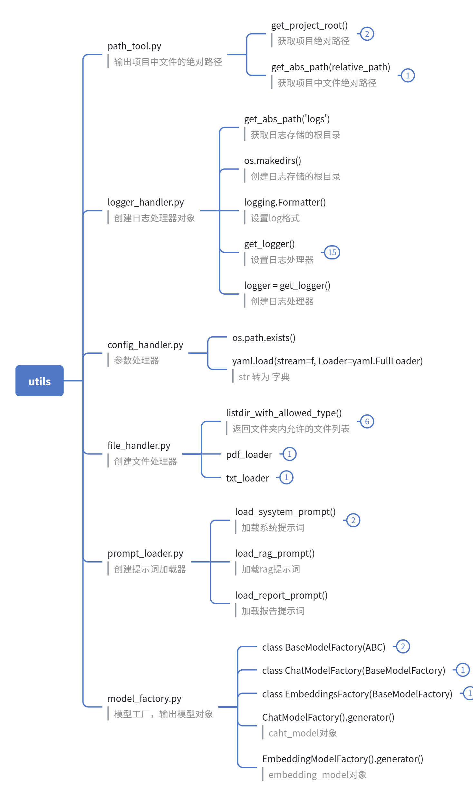
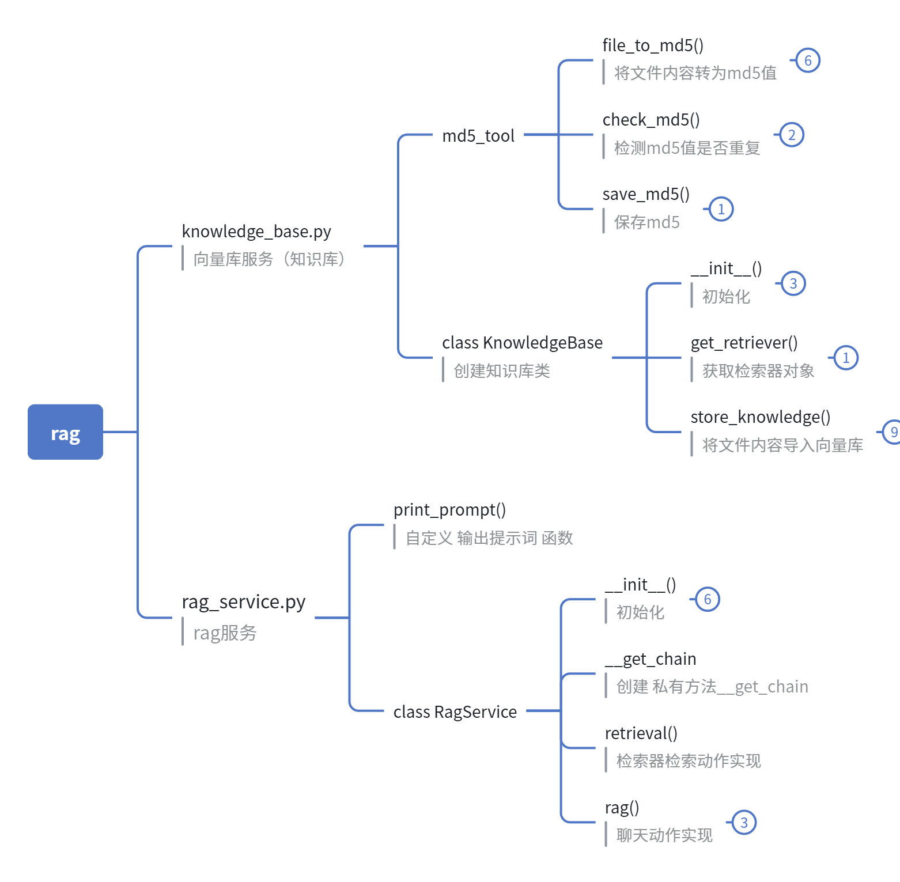
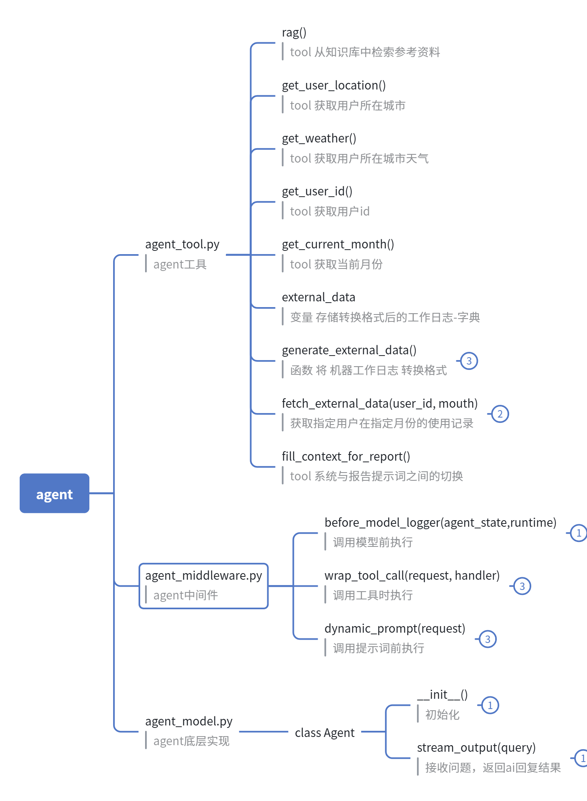
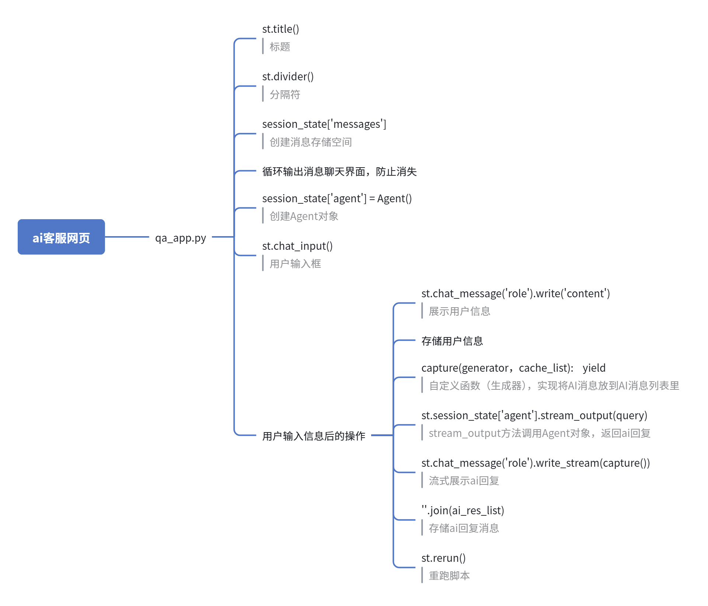

# 扫地机器人 AI 智能客服

基于 **LangChain Agent + RAG** 构建的扫地/扫拖机器人垂直领域智能客服系统。通过 Streamlit 提供流式对话界面，Agent 具备 ReAct 自主思考与多工具调用能力，可完成专业知识问答、环境适配判断与个性化使用报告生成。

## 项目概述

### 定位

面向扫地机器人售后与售前咨询场景的 AI 客服应用，将大模型、检索增强生成（RAG）与工具调用（Function Calling）结合，替代传统关键词客服，提供专业、准确、个性化的回答。

### 核心功能

| 功能 | 说明 |
| --- | --- |
| 流式智能对话 | Streamlit 聊天界面，逐字流式输出 AI 回复 |
| ReAct Agent | 遵循「思考 → 行动 → 观察 → 再思考」流程，自主决策工具调用 |
| RAG 知识检索 | 基于 Chroma 向量库检索产品问答、选购指南、故障排除、维护保养等资料 |
| 环境适配判断 | 调用天气工具，结合用户所在城市判断是否适合使用机器人 |
| 个性化使用报告 | 获取用户 ID 与月份，检索外部使用记录，动态切换报告提示词生成 Markdown 报告 |
| 中间件体系 | 模型调用日志、工具调用监控、报告场景动态提示词切换 |
| 知识库增量导入 | 支持 txt / pdf 文档导入，MD5 去重避免重复入库 |

### 设计目标

- **分层清晰**：入口层（qa_app）、Agent 层（agent）、检索层（rag）、工具层（utils）职责单一。
- **配置驱动**：模型名称、向量库参数、提示词路径全部由 `config/` 下 YAML 管理，改配置不改代码。
- **提示词外置**：系统提示词、RAG 总结提示词、报告提示词独立存放于 `prompts/`，便于迭代调优。
- **可观测**：统一的日志工具，模型调用与工具执行全链路留痕。

## 技术栈

| 类别 | 技术 / 框架 | 版本 |
| --- | --- | --- |
| 语言 | Python | ≥ 3.10（开发环境 3.13） |
| Web 界面 | Streamlit | 1.51.0 |
| Agent 框架 | LangChain（`create_agent` + Middleware） | 1.4.0 |
| 模型集成 | langchain-community（ChatTongyi / DashScopeEmbeddings） | 0.4.2 |
| 大模型 | 通义千问（qwen3.7-max，DashScope API） | - |
| 向量模型 | text-embedding-v4（DashScope API） | - |
| 向量数据库 | Chroma / langchain-chroma | 1.5.9 / 1.1.0 |
| 文本分块 | langchain-text-splitters | 1.1.2 |
| PDF 解析 | pypdf（经 PyPDFLoader） | 6.19.0 |
| 配置管理 | PyYAML | 6.0.3 |
| 模型 SDK | dashscope | 1.27.5 |

## 快速开始

### 1. 环境要求

- Python 3.10 及以上
- 可访问阿里云 DashScope 服务，并已获取 API Key

### 2. 安装依赖

```bash
pip install -r requirements.txt
```

### 3. 配置说明

**API Key（必需）**：ChatTongyi 与 DashScopeEmbeddings 从环境变量读取密钥：

```bash
# Windows (PowerShell)
$env:DASHSCOPE_API_KEY = "sk-your-api-key"
# Linux / macOS
export DASHSCOPE_API_KEY="sk-your-api-key"
```

**配置文件**（`config/` 目录，按需修改）：

| 文件 | 作用 | 关键项 |
| --- | --- | --- |
| `rag.yml` | 模型选择 | `chat_model_name`、`embedding_model_name` |
| `chroma.yml` | 向量库与分块 | `persist_directory`（默认 `chroma_db`）、`k`（召回条数）、`chunk_size` / `chunk_overlap`、`data_path`（知识源目录）、`md5_path`（去重记录） |
| `prompts.yml` | 提示词路径 | 系统 / RAG / 报告三份提示词文件位置 |
| `agent.yml` | Agent 外部数据 | `external_data_path`（使用记录 CSV） |

### 4. 构建知识库

将知识文档（`.txt` / `.pdf`）放入 `data/` 目录后执行：

```bash
python -m rag.knowledge_base
```

脚本会加载并切分文档、写入 Chroma 持久化目录（`chroma_db/`），并通过 `md5.txt` 记录文件指纹实现增量去重导入。

### 5. 启动应用

```bash
streamlit run qa_app.py
```

浏览器访问 `http://localhost:8501` 即可开始对话。

## 使用说明

### 对话示例

| 场景 | 示例提问 | Agent 行为 |
| --- | --- | --- |
| 故障排查 | 机器人充不进电怎么办？ | 调用 `rag` 检索知识库并总结 |
| 选购咨询 | 小户型适合哪些扫地机器人？ | 调用 `rag` 检索选购指南 |
| 环境适配 | 今天适合用扫地机器人吗？ | `get_user_location` → `get_weather` |
| 使用报告 | 给我生成我的使用报告 | `get_user_id` → `get_current_month` → `fill_context_for_report` → `fetch_external_data`，切换报告提示词生成 Markdown 报告 |

### Agent 工具箱

| 工具 | 入参 | 用途 |
| --- | --- | --- |
| `rag` | `query` | 从向量库检索专业资料并生成概括回答 |
| `get_user_location` | 无 | 获取用户所在城市 |
| `get_weather` | `city` | 获取指定城市天气、湿度、降雨概率 |
| `get_user_id` | 无 | 获取当前用户 ID |
| `get_current_month` | 无 | 获取当前月份（YYYY-MM） |
| `fetch_external_data` | `user_id`, `month` | 查询用户指定月份的使用记录 |
| `fill_context_for_report` | 无 | 注入报告上下文，触发提示词动态切换 |

### 常见操作

- **更新知识库**：把新文档放入 `data/`，重新执行 `python -m rag.knowledge_base`，已入库文件自动跳过。
- **更换模型**：修改 `config/rag.yml` 中的模型名称即可。
- **调试单模块**：`python -m rag.rag_service`（单独测试 RAG 链路）、`python -m agent.agent_model`（终端测试 Agent）。
- **查看运行日志**：控制台输出 INFO 级日志，DEBUG 级日志落盘至 `logs/` 目录。

## 项目结构

```
Agent_Project/
├── qa_app.py                # Streamlit 应用入口（聊天界面、流式输出）
├── agent/                   # Agent 核心层
│   ├── agent_model.py       #   Agent 封装：create_agent + 流式输出
│   ├── agent_tool.py        #   7 个工具的注册与实现
│   └── agent_middleware.py  #   中间件：调用日志、工具监控、动态提示词
├── rag/                     # RAG 检索层
│   ├── knowledge_base.py    #   知识库构建：加载、分块、入库、MD5 去重
│   └── rag_service.py       #   检索 + 提示词 + LLM 总结链路
├── utils/                   # 公共工具层
│   ├── model_factory.py     #   Chat / Embedding 模型工厂
│   ├── config_handler.py    #   YAML 配置加载
│   ├── prompt_loader.py     #   提示词文件加载
│   ├── file_handler.py      #   txt / pdf 文档加载
│   ├── logger_handler.py    #   日志器（控制台 + 文件）
│   └── path_tool.py         #   项目根路径与绝对路径工具
├── config/                  # YAML 配置（rag / chroma / prompts / agent）
├── prompts/                 # 提示词模板（系统 / RAG 总结 / 报告）
├── data/                    # 知识库源文档 + external/records.csv 使用记录
├── images/                  # 模块结构脑图
│   ├── qa.png               #   入口层结构
│   ├── agent.png            #   Agent 层结构
│   ├── rag.png              #   RAG 层结构
│   └── utils.png            #   工具层结构
├── chroma_db/               # Chroma 持久化目录（运行时生成）
└── logs/                    # 运行日志目录（运行时生成）
```

### 工作流程

```
用户提问 (Streamlit)
   → Agent (LangChain create_agent)
      → 中间件：记录日志 / 动态提示词
      → 工具决策：rag | weather | user_id | fetch_external_data ...
         → RAG：Chroma 向量检索 → LLM 总结
      → 流式返回 → 逐字输出
```

## 项目框架
### 1. 工具模块架构图


### 2. RAG模块架构图


### 3. Agent模块架构图


### 4. 聊天网页模块架构图
